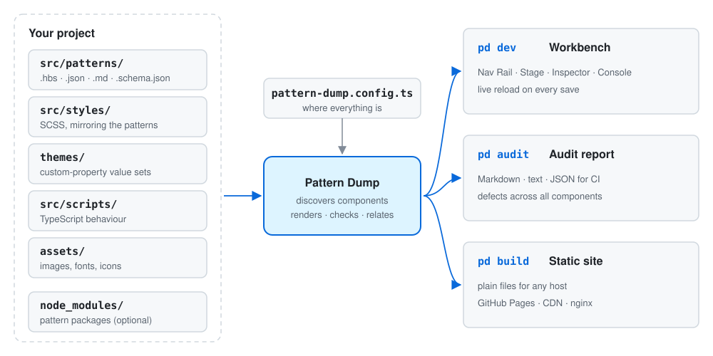

# Pattern Dump

A workbench for HTML and CSS design systems, and a successor to PatternLab. Write components as
Handlebars templates with SCSS, data and Markdown docs; Pattern Dump shows them live, checks them, maps
how they relate, and publishes the result as a static site.

> **Alpha.** Pattern Dump works end to end, but options and file conventions can
> still change between releases.



## What it does

- **Live workbench.** Every component and variant in a live preview, with themes, viewport sizes,
  colour-vision simulation and reload on save for templates, data, docs, styles, themes and scripts.
- **Docs next to the code.** Markdown docs with live examples and source that can't drift from the
  component, because they are rendered from it.
- **Relationships.** Which components each one uses and is used by, including CSS classes borrowed from
  other components.
- **Checks.** Render errors, schema mismatches, HTML validation and accessibility findings per component,
  and a corpus-wide audit (`pd audit`) with machine-readable output for CI.
- **Static publishing.** `pd build` writes the whole workbench as plain files for any static host.
- **Pattern packages.** Use a design system from npm next to your own components.
- **Your conventions.** Components are found wherever their templates live; PatternLab-style `~`
  variants and existing Handlebars helpers work.

## Requirements

Node.js 22.22 or later, and npm.

## Quick start

Pattern Dump is on npm as an alpha. Create a project with it:

```bash
npx pattern-dump@alpha init my-design-system
cd my-design-system
npm run dev              # → http://localhost:4000
```

To try changes that are not released yet, build the package from this repository and create the project
from the file:

```bash
git clone <this repository> pattern-dump
cd pattern-dump
npm install
npm run pack:pd          # → .pd-pack/pattern-dump-<version>.tgz

cd ..
TGZ="$PWD/pattern-dump/.pd-pack/pattern-dump-<version>.tgz"
npx --package="$TGZ" pd init my-design-system --pd-source "$TGZ"
```

Day to day:

```bash
npm run dev              # the workbench, with live reload
npm run audit            # defects across every component
npx pd build             # a static site in ./dist
```

## Documentation

| Guide | |
|---|---|
| [Getting started](docs/guide/getting-started.md) | Create a project, tour the workbench, add a component, audit and publish |
| [Authoring components](docs/guide/authoring.md) | Templates, variants, data, docs, ordering, styles, scripts and assets |
| [Configuration](docs/guide/configuration.md) | Every option in `pattern-dump.config.ts` |
| [Themes](docs/guide/themes.md) | Writing and switching themes |
| [Pattern packages](docs/guide/pattern-packages.md) | Using and publishing design systems as npm packages |
| [Static build](docs/guide/static-build.md) | `pd build`: options, hosting and troubleshooting |
| [Command line](docs/guide/cli.md) | Every `pd` command and option |

## Developing Pattern Dump

All documentation: [docs/](docs/README.md). See [CONTRIBUTING.md](CONTRIBUTING.md) for setup, the checks every change has to pass, and the rules the
code base depends on. [docs/development/architecture.md](docs/development/architecture.md) describes how the code is organised.

## License

[MIT](LICENSE) © 2026 [n8d](https://n8d.at) and contributors
