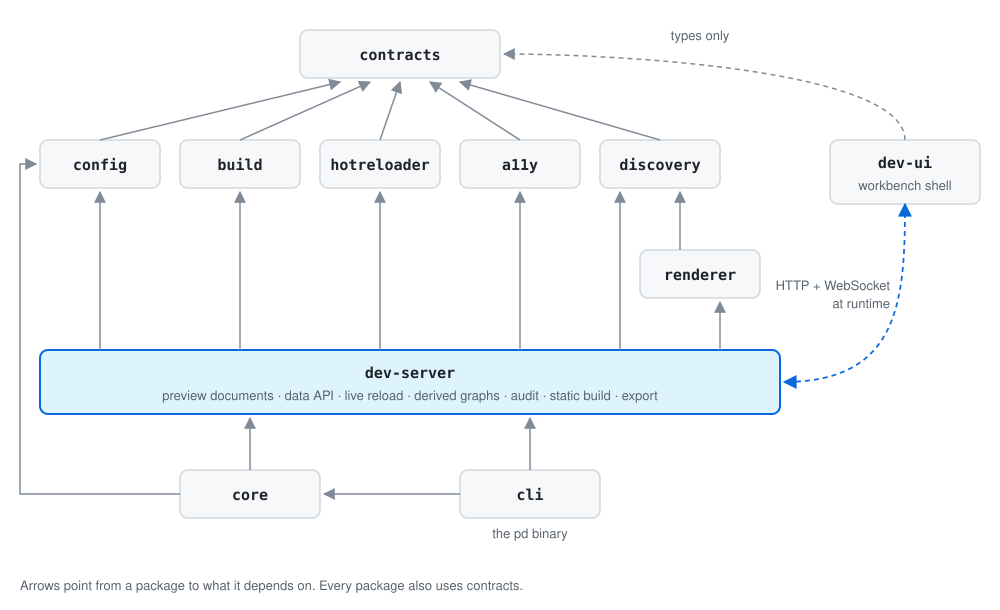

# Architecture

How the Pattern Dump tool itself is organised as source code. For how a design system built with
Pattern Dump is laid out, see the [authoring guide](../guide/authoring.md).

---

## Tooling

- **Monorepo:** Nx for the task graph, affected-only runs and a local computation cache. No Nx Cloud, no
  distributed execution.
- **Package manager:** npm workspaces, declared in the root `package.json`. No pnpm, no yarn.
- **Language:** TypeScript, ESM throughout. No JavaScript source, no CommonJS.
- **Transpile and bundle:** esbuild. **Type check:** `tsc --noEmit`, as a separate target.
- **Test:** Vitest (unit and integration), Playwright with axe-core (end-to-end and accessibility).
- **Lint:** ESLint 9 (one flat config at the root) for TypeScript; Stylelint for SCSS.
- **Build and HMR core:** `@pattern-dump/build` and `@pattern-dump/hotreloader`, in-tree: Sass with
  Autoprefixer, esbuild for TypeScript, Chokidar watching, an SCSS dependency graph, and `ws` hot reload.

---

## Repository layout

```
pattern-dump/
├── package.json            # workspace root: packages/*, apps/*, test-bench
├── nx.json                 # local cache + task graph
├── tsconfig.base.json      # ESM, path aliases for @pattern-dump/*
├── vitest.workspace.ts     # Vitest across all packages
├── eslint.config.js        # one ESLint flat config for every project
├── CONTRIBUTING.md
├── docs/
│   ├── guide/              # for people using Pattern Dump
│   └── development/        # for people working on its code (this folder)
├── packages/
│   ├── contracts/          # @pattern-dump/contracts   the seams between packages
│   ├── config/             # @pattern-dump/config      config loading and types
│   ├── build/              # @pattern-dump/build       build core
│   ├── hotreloader/        # @pattern-dump/hotreloader HMR core
│   ├── discovery/          # @pattern-dump/discovery   component identity
│   ├── renderer/           # @pattern-dump/renderer    Handlebars, highlighting
│   ├── a11y/               # @pattern-dump/a11y        axe rule tiers
│   ├── dev-server/         # @pattern-dump/dev-server  pd dev, audit, static build, export
│   ├── core/               # @pattern-dump/core        command orchestration
│   └── cli/                # @pattern-dump/cli         the `pd` binary and the distributable
├── apps/
│   └── dev-ui/             # the workbench shell (browser bundle); Playwright suite in e2e/
├── scripts/                # verify-install, dev-server freshness check
└── test-bench/             # the sandbox design system the tool runs against; the E2E fixture
```

---

## Packages

| Package | Responsibility | Depends on |
|---|---|---|
| `contracts` | The seams: TypeScript types plus a few pure helpers (URL builders, the audit rollup, `staticPathFor`). Defines `render()`, the dev-server ↔ dev-ui data API and the HMR protocol, versioned by `PD_PROTOCOL_VERSION`. | — |
| `config` | Loads `pattern-dump.config.ts` / `.json` (TypeScript wins). Shared config types. | contracts |
| `build` | esbuild (TypeScript), Sass + Autoprefixer, Chokidar watching, incremental builds, the SCSS dependency graph. | contracts |
| `hotreloader` | `ws`-based hot-reload server and browser client. | contracts |
| `discovery` | Filesystem → components: `buildDiscoveryMap` returns `{ discoveryMap, handleMap, collisions }`, plus `collapseComponentId`. Every derived graph keys on it; nothing else reconstructs a component's file path. | contracts |
| `renderer` | Handlebars → HTML, Shiki highlighting, data cascade. | contracts, discovery |
| `a11y` | axe-core integration: the rule-tier classifier and the structural a11y producer. | contracts |
| `dev-server` | Serves preview documents and the data API, wires watch → derived graphs → HMR. Also hosts the audit engine, the static build (`src/static-build.ts`) and `pd export` (`src/export.ts`, `src/flattening.ts`). | contracts, config, discovery, build, hotreloader, renderer, a11y |
| `core` | Orchestration: `runDev`, `runAudit`, `runBuild`, `runExport`, and config loading. | contracts, config, dev-server |
| `cli` | The `pd` binary (`init`, `dev`, `audit`, `build`, `export`) and the distributable (`npm run pack:pd`). | core, contracts, dev-server |
| `dev-ui` (app) | The workbench shell: Nav Rail, Stage, Inspector, Console. Talks to the dev-server over HTTP and the HMR socket. **Build-time dependency: `contracts` only.** | contracts (build time); dev-server (runtime) |

---

## Dependency direction

The graph is acyclic: `contracts` at the top, the integrators below it. ESLint enforces the dev-ui rules.



There is no separate graph package. The four derived graphs (composition, style, style modules and
diagnostics) are built inside `dev-server` from one compile, all keyed on `discovery`'s
`collapseComponentId`.

**Known deviation:** `contracts` is not a pure-types leaf. `src/dev-protocol.ts` ships runtime helpers
(`buildAuditRollup`, the URL builders, `staticPathFor`) because `dev-server` and `dev-ui` both need the
same logic and no shared-logic package exists.

---

## Nx targets

Every package exposes the same cacheable targets:

| Target | Tool |
|---|---|
| `build` | esbuild |
| `test` | Vitest |
| `lint` | ESLint |
| `typecheck` | `tsc --noEmit` |

`dev-ui` additionally has `lint:css` (Stylelint) and `e2e` (Playwright). Nx infers targets from each
project's `package.json` scripts, so check `nx show project <name>` rather than `project.json` alone.

---

## Conventions

- Each package has `src/`, its own `project.json`, and a `tsconfig.json` extending `tsconfig.base.json`.
- Packages import each other by name (`@pattern-dump/*`, resolved through `tsconfig.base.json`), never by
  relative path.
- `"type": "module"` in every `package.json`.
- **`contracts` is the seam.** A cross-package shape change is a `contracts` change first.
- Everything is `@pattern-dump/*` internally. What installs into a project is one self-contained
  package, `pattern-dump` (`PD_PACKAGE_NAME` in `packages/cli/src/distribution.ts`), built by
  `npm run pack:pd`: every workspace package bundled into the `pd` binary, third-party packages as real
  dependencies, and the dev-ui bundle and `pd init` templates next to it. `npm run verify:install`
  proves it works outside the repo.
- **Dev-UI styles** are modular SCSS: `@use`/`@forward` (never `@import`), folders by layer
  (`abstracts/`, `base/`, `layout/`, `regions/`), each with an `_index.scss`. See [styling.md](styling.md).
- **Units by purpose.** Type and text spacing in `rem`/`em`; grid structure in `fr`/`auto`/`%`/
  `min-content`/`max-content`; layout and chrome dimensions in `vw`/`vh`. Resizing converts the settled
  `px` value to viewport units before storing it. Hairline borders may be `px`. Enforced by Stylelint's
  `unit-disallowed-list`.

---

## Three theming systems (keep strictly separate)

"Theme" means three different things in Pattern Dump.

| # | System | What it themes | Mechanism | Where it lives |
|---|---|---|---|---|
| 1 | **Shell theme** | The workbench chrome (navigation, panels, typography) | Shell custom properties from [palette.md](palette.md) | The shell's own document |
| 2 | **Component theme** | The documented design system's themes | Custom-property value sets, switched by `data-theme` or by swapping a stylesheet | Inside the **preview iframe** |
| 3 | **Syntax-highlighter theme** | Code colours in the Console and in Markdown fences | Shiki dual themes following `prefers-color-scheme` | The shell's Console and docs |

They are independent. Switching the component theme never touches the shell or the code colours; the
highlighter follows the operating system; the shell never reaches into the iframe. The iframe boundary
enforces the split between #2 and the other two.

---

## Decisions

- **npm workspaces** over pnpm or yarn: one toolchain, nothing extra to install or pin. Nx adds the task
  graph and cache.
- **`contracts` depends on nothing** and everything depends on it, so a seam change is one reviewable
  edit.
- **The build core is in-tree.** `@pattern-dump/build` and `@pattern-dump/hotreloader` descend from ICE,
  n8d's build tool for PatternLab, folded in as ordinary Pattern Dump packages.
- **No separate compiler package.** Behaviour scripts are compiled by `build`'s esbuild integration.
- **Graphs build on the compile.** The class-ownership index comes from compiled CSS source maps, not
  from regular expressions over SCSS, so BEM expansions (`&__element`, `&--modifier`) are attributed to
  the component that defines them.
- **`dev-server` is its own package**, not folded into `cli`, so `dev-ui` and tests can use it directly.

---

## Style coupling

Components share styles **only through shared `@use` modules** (base, tokens, mixins). A component's SCSS
must not `@use` another component's SCSS.

Cross-component coupling shows up as **class borrowing in markup**: when a template uses a class
defined in another component's SCSS, the relationships index creates a `styleUses` edge, shown as a
link in the Inspector's Relationships tab. If a component's SCSS does `@use` another component's SCSS,
the target appears as a plain, non-navigable path in `styleUsesModules`.
