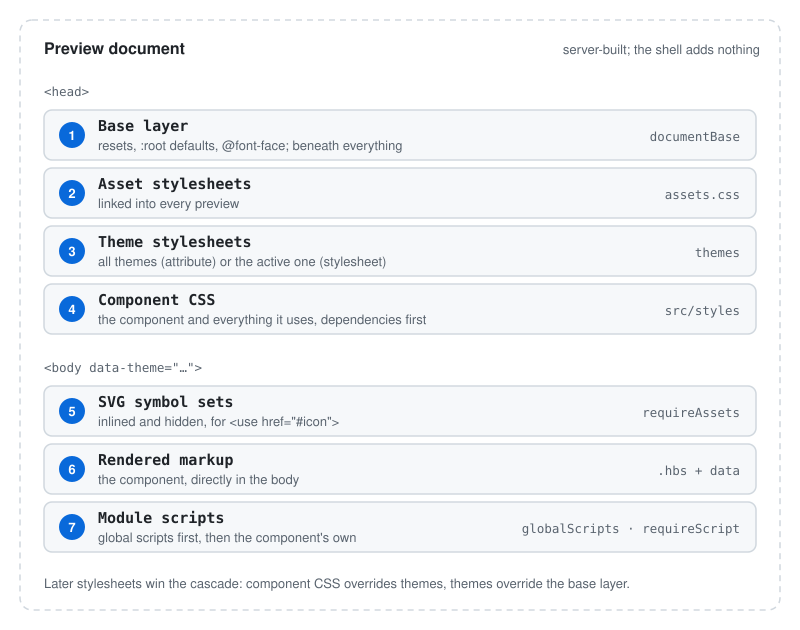

# Authoring components

Everything about writing a design system for Pattern Dump: components, variants, data, docs, ordering,
styles, behaviour scripts and assets. Folder names below are the starter's defaults; the config can point
anywhere ([configuration.md](configuration.md)).

## Components

**Every `.hbs` file under the patterns folder is a component**, wherever it lives. Folders only group
components; they never change a component's identity.

| File | Component id | Handle |
|---|---|---|
| `atoms/button/button.hbs` | `atoms/button` | `atoms-button` |
| `atoms/button.hbs` | `atoms/button` | `atoms-button` |
| `molecules/search-field/search-field.hbs` | `molecules/search-field` | `molecules-search-field` |
| `molecules/search-field/input/input.hbs` | `molecules/search-field/input` | `molecules-input` |
| `00-atoms/badge/badge.hbs` | `00-atoms/badge` | `atoms-badge` |

- The **id** is the path without the file extension. A file named like its folder (`button/button.hbs`)
  takes the folder's id. A numbered folder or file (`00-atoms`) keeps its number in the id and the
  route, but not in the handle, as in PatternLab.
- The **handle** is the first folder plus the component name. It is how templates include each other.
- Two components with the same handle **collide**: the first by sorted path keeps the handle, the other
  is left out of the tree and shows a `HANDLE_COLLISION` diagnostic naming both files. Rename or move one.

Files belonging to a component sit next to its template and share its name:

| File | Role | Required |
|---|---|---|
| `button.hbs` | Handlebars template | yes (or variants only, see below) |
| `button.json` | Default data | no |
| `button.md` | Docs and metadata | no |
| `button.schema.json` | Data schema | no |
| `button~<variant>.json` / `.hbs` | A variant | no |

## Including components

Include another component with its handle, passing data as arguments:

```handlebars
<form class="search-field" role="search">
  {{> molecules-input }}
  {{> atoms-button label=buttonLabel type="submit" }}
</form>
```

A variant handle contains `~`, which is Handlebars' whitespace-control character, so **quote it**:

```handlebars
{{> "atoms-button~secondary" }}
```

Every include shows up in the Inspector's **Relationships** tab, in both directions.

## Variants

A variant is a sibling file named `<name>~<variant>`:

- **`button~secondary.json`:** a data overlay. Same markup as the base, with this data merged over the
  base's data.
- **`button~icon.hbs`:** its own markup. It still gets the base's data, and can have its own
  `button~icon.json` on top.

A component can consist of variants alone, with no `button.hbs`. The workbench then shows the variants,
each selectable, and a gallery of all of them.

A variant with no `.md` of its own shows the base component's documentation.

## Data

A component renders with data merged in this order, later winning:

1. Global data: every `*.json` in `dataDir`, if configured
2. The component's `<name>.json`
3. The variant's `<name>~<variant>.json`

Objects merge deeply; anything else (strings, numbers, arrays) is replaced. When one component includes
another, arguments passed to the include (`{{> atoms-button label="Save" }}`) apply inside that
include.

### Schema

`<name>.schema.json` is a JSON Schema for the component's data. It is shown in the Console's **Source**
tab, and the merged data is checked against it on every render:

- a property listed in `required` but missing is an error (`UNFILLED_REQUIRED`);
- a property whose value doesn't match its `type` is a warning (`SHAPE_MISMATCH`).

### Helpers

Built in:

| Helper | Use |
|---|---|
| `id` | `{{id 'label'}}` returns a stable id, unique per component instance, for `id`/`for`/`aria-*` pairs. Pass `base="…"` to an include to make the ids predictable. |
| `getId`, `getLastId`, `getLastNumericId` | PatternLab-compatible id helpers |
| `eq`, `ne`, `lt`, `lte`, `gt`, `gte`, `and`, `or`, `not` | Comparisons for `{{#if}}` |
| `ifCond`, `isdefined`, `defaultValue` | Conditional and default-value helpers |

Add your own with the `helpers` config option ([configuration.md](configuration.md#data-and-helpers)).

## Docs and metadata: `<name>.md`

The Markdown body is shown in the Inspector's **Docs** tab. The frontmatter at the top holds metadata:

```md
---
title: Button
description: Triggers an action.
status: stable
---

Triggers an action. `variant` picks the emphasis.
```

| Key | Values | Effect |
|---|---|---|
| `title` | text | Name in the Nav Rail and Inspector (default: the file name) |
| `description` | text | One-line summary |
| `status` | `draft` (default), `stable`, `deprecated` | Shown with the component |
| `deprecated-use` | text | What to use instead of a deprecated component |
| `visibility` | `public` (default), `private` | Private components are hidden from the tree until **Show private** is on, and left out of folder galleries |
| `order` | number | Position among its siblings, see [Order](#order) |
| `preview` | `centered`, `full` | How the Stage frames the preview, see [Preview layout](#preview-layout) |
| `requireScript` | script id | Loads a behaviour script, see [Behaviour scripts](#behaviour-scripts) |
| `requireAssets` | asset id | Inlines an SVG symbol set, see [Assets](#assets) |

Raw HTML in Markdown is escaped, and only `http(s)`, `mailto`, `tel`, relative and `pattern:` links are
allowed.

### Live examples and source in docs

Fenced blocks with these languages are replaced when the docs render. Name the component on the fence
line or on the first line inside it:

| Fence | Renders |
|---|---|
| ` ```pattern atoms/button~secondary ` | The live component (styled by the workbench) |
| ` ```src-template atoms/button ` | Its Handlebars source |
| ` ```src-data atoms/button~secondary ` | Its data; for a variant, merged with the base |
| ` ```src-html atoms/button ` | Its rendered HTML |

Any other language is syntax-highlighted.

Link to another component with a `pattern:` link, which becomes an in-app link: `[the button](pattern:atoms/button)`
or `[secondary](pattern:atoms/button~secondary)`. A link to a component that doesn't exist is marked as
unresolved.

## Folders: `index.md`

A folder's `index.md` gives it a title, a description on its folder page, and controls its children:

```md
---
title: Atoms
preview: centered
order: [button, ..., badge]
---

The smallest building blocks.
```

| Key | Effect |
|---|---|
| `title` | Folder name in the Nav Rail (default: the folder name, capitalised) |
| `order` | A list of child names, or the folder's own number among its siblings |
| `visibility` | `private` hides the folder like a private component |
| `overview` | `false` turns off this folder's gallery page |
| `preview` | Default preview layout for components in this folder (top-level folders only) |

`src/patterns/index.md` orders the top-level folders.

### Order

Siblings in the Nav Rail and in folder galleries are sorted by:

1. **Their own number.** `order: <number>` in a component's `.md` or a folder's `index.md`. Without one,
   the number is `0`. Lower comes first, so `order: -10` moves an entry before every unnumbered sibling
   and `order: 10` after them.
2. **The parent's list,** for entries with the same number. `order: [atoms, molecules, ..., pages]` puts
   named children in that order. `...` stands for every child the list doesn't name, so a folder you add
   later needs no edit to the list. Without `...`, unnamed children come after the named ones.
3. **The alphabet,** with numbers compared numerically (`item2` before `item10`).

### Folder pages

Every folder with at least one public component gets a gallery page showing its components, in tree
order, with the text of its `index.md` above them. Set `overview: false` in a folder's `index.md` to turn
its page off, or `overviews: false` in the config to turn them all off.

### Preview layout

- **`centered`**: the preview frame is as wide as the component's content and centred in the Stage,
  and as tall as the content. The page itself is not changed to get there, so a component that fills
  its container (a full-width input, a progress bar) shows at full width, as it would on a page. A
  component whose height comes from the viewport (`height: 100vh`, a percentage chain) cannot be
  fitted — its height would follow the frame's — so the frame keeps its last steady height and the
  content scrolls inside it; the Console says when that happens.
- **`full`**: the component fills the Stage, for pages and layouts.

Components in `pages/` and `templates/` default to `full`, everything else to `centered`. The folder's
number does not matter, so `05-pages` counts as `pages`. A top-level folder's `index.md` overrides the
default for every component in it; a component's own `.md` overrides both.

## Styles

Styles live in a separate SCSS tree that mirrors the patterns: `src/styles/atoms/button.scss` holds the
styles for `atoms/button`. Every `.scss` file not starting with `_` is compiled, unless the config names
specific entry files.

Folder numbers (`00-atoms`, `01-molecules`) don't have to match between the two trees:
`styles/00-atoms/_badge.scss`, `styles/atoms/_badge.scss` and `styles/01-atoms/_badge.scss` all style the
component `00-atoms/badge` or `atoms/badge`. An exact path match wins. A file that matches two
components by name alone, such as `atoms/_badge.scss` next to both `00-atoms/badge` and
`01-atoms/badge`, belongs to neither: its rules go into the base layer.

- **Which component owns a class** is worked out from the compiled CSS, through source maps. Each
  preview links only the CSS of the component and the components it uses.
- **Shared rules** with no single owner (resets, document defaults, `@font-face`) go in the base layer,
  turned on by `documentBase` in the config and linked beneath every preview. A file or folder listed
  there always goes into it, even one that belongs to a component; `"."` makes every stylesheet
  global ([configuration.md](configuration.md#documentbase)).
- **Share code between components** through `@use` modules (tokens, mixins), not by importing another
  component's stylesheet.
- **Load an installed package by name:** `@use '@scope/pkg/sass/tokens'` is found in the `node_modules`
  folders from the stylesheet upward, as in Node, and `@use 'pkg:@scope/pkg'` uses the package's own
  Sass entry. No `SASS_PATH` or load-path setting is needed.
- A template that uses a class owned by another component shows up in **Relationships** as a borrowed
  class.

Theme values belong in themes, see [themes.md](themes.md).

### What a preview contains

Every preview is a complete HTML document built by the server, in this order:



The markup sits directly in `<body>`, with no wrapper around it. The workbench never adds anything to
the document, so what you see in the Stage is what your markup and CSS produce.

## Behaviour scripts

A script is a TypeScript module in the scripts folder (`scriptsDir`), for example
`src/scripts/search-field.ts`. A component loads it by naming it in its `.md`:

```md
---
title: Search field
requireScript: search-field
---
```

`requireScript: [search-field]` works too.

For several scripts, repeat the line (`requireScript: a` and `requireScript: b` on separate lines);
they load in that order.

- Every preview that shows the component loads the script, including previews of components that
  include it. Each script loads once, as a module, after the markup.
- `pd dev` compiles scripts with esbuild on request and reloads the preview when one changes. There is no
  build step while you work.
- To load a script into every preview, list it in the config: `globalScripts: ["<id>"]`. A full URL
  there loads an external script.
- Scripts are TypeScript: an id resolves as `<scriptsDir>/<id>.ts` and nothing else, so a `.js` file
  of the same name does not satisfy it. `pd dev` names every id that cannot resolve at startup, and
  the script's URL answers 404 saying which file it expected and where.

The starter's `tsconfig.json` covers `src/scripts` for your editor and two scripts:

```bash
npm run typecheck      # tsc --noEmit
npm run build:scripts  # tsc → lib/scripts/*.js and *.d.ts
```

To let another package in your repository import the compiled scripts, export them from
`package.json`:

```json
"files": ["lib/scripts"],
"exports": { "./package.json": "./package.json", "./scripts/*": "./lib/scripts/*" }
```

## Assets

Files in the assets folder are served at `/assets/`, with the path mirroring the folder:
`assets/images/logo.svg` is `/assets/images/logo.svg`. Use that path in templates and CSS. With several
asset folders, each is served under its folder name (`/assets/images/…`, `/assets/fonts/…`).

A reference that starts with an asset folder's name also works, as PatternLab projects write it:
`/images/logo.svg` and `../../images/logo.svg` are rewritten to `/assets/images/logo.svg`, in templates
and in `url()` in your styles and themes. Stylesheets listed in `assets.css` are served as they are.

A path to a file that doesn't exist returns 404, so a broken image, font or `url()` shows up as a failed
request in the browser's network panel.

`assets.css` in the config lists stylesheets to link into every preview, before the component styles:
paths relative to the assets folder, or full URLs, for example a web-font stylesheet:

```ts
assets: {
  dir: "./assets",
  css: ["https://fonts.googleapis.com/css2?family=Arimo&display=swap", "css/site.css"],
},
```

### SVG

- **Inline** SVG in the template when it should follow `currentColor` and theme values.
- **Reference** a file with `` or `background-image` for static graphics.
- **Inline a symbol set** for themeable icons: `requireAssets: icons` in the component's `.md` inlines
  `assets/icons.svg` (or `assets/images/icons.svg`), hidden, at the top of the preview. Use a symbol with
  `<svg><use href="#icon-name"/></svg>`. The set is inlined once per preview, including for components
  that include this one. A symbol used from the same document inherits `currentColor` and the theme's
  custom properties; one referenced from an external file does not reliably.
