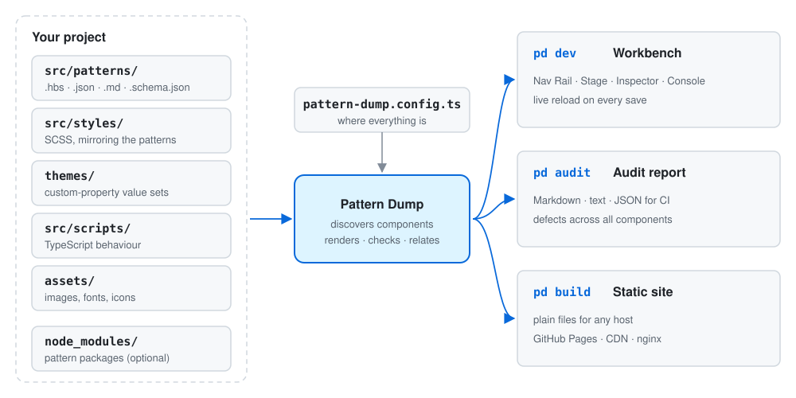

# Getting started

This guide takes you from an empty folder to a running workbench, a first component, an audit and a
static build.



**Requirements:** Node.js 20.10 or later, and npm.

## 1. Create a project

Pattern Dump installs into each project as a development dependency. `pd init` writes a starter
project and installs it.

```bash
npx pattern-dump@alpha init my-design-system
```

Pattern Dump is published as an alpha, so name the `alpha` tag. To try changes that are not released yet,
build the package from a clone of this repository and create the project from the file:

```bash
# in a clone of the Pattern Dump repository
npm install
npm run pack:pd          # → .pd-pack/pattern-dump-<version>.tgz

# anywhere else
npx --package=/path/to/pattern-dump-<version>.tgz pd init my-design-system --pd-source /path/to/pattern-dump-<version>.tgz
```

`pd init` asks for:

| Question | Flag | Default |
|---|---|---|
| Package name | `--name <name>` | the folder name |
| Title in the Nav Rail | `--brand <title>` | the name |
| Include the starter components? | `--no-examples` to skip | yes |
| Include a website (storefront)? | `--storefront` | no |
| Run `git init`? | `--git` / `--no-git` | yes, unless already inside a repository |
| Run `npm install`? | `--no-install` to skip | yes |

A website adds pages written in markdown, a small skin and a GitHub Pages workflow; see
[storefront.md](storefront.md#quick-start). `--yes` accepts every default without asking. In a folder that already has a `package.json`, `pd init`
adds to the project and never overwrites a file; a script name that is taken gets a `pd:` prefix instead.

A global install (`npm install --global pattern-dump@alpha`) also works for creating projects, but each
project still uses its own local copy; see [global or local](cli.md#global-or-local).

## 2. What you get

```
my-design-system/
├── pattern-dump.config.ts     where everything is; every path resolves against this folder
├── package.json               dev, audit, typecheck and build:scripts scripts
├── tsconfig.json              TypeScript for the behaviour scripts
├── src/
│   ├── patterns/              components: .hbs templates, .json data, .md docs, .schema.json
│   │   ├── index.md           orders the top-level folders
│   │   ├── atoms/button/
│   │   ├── molecules/search-field/   (with a private input sub-component)
│   │   └── pages/example/
│   ├── styles/                SCSS mirroring src/patterns/
│   │   └── base/              shared rules linked beneath every preview
│   └── scripts/               behaviour scripts (TypeScript)
├── themes/
│   ├── light.theme.scss
│   └── dark.theme.scss
└── assets/                    served at /assets/
```

Each starter component shows one convention: variants as data or as their own markup, including one
component inside another, a private sub-component, a full-page layout and a behaviour script. The
project's own `README.md` summarises the conventions.

## 3. Run the workbench

```bash
cd my-design-system
npm run dev              # → http://localhost:4000
```

Edits to templates, data, docs, styles, themes and scripts show up without a page reload.

The workbench has four regions:

| Region | What it holds |
|---|---|
| **Nav Rail** (left) | The component tree and search; the theme picker; **Accessibility** (colour-vision simulation); viewport sizes (fit, fit content, mobile, tablet, desktop); buttons to show or hide the Inspector and Console; **Show private**; **Hide packages** when pattern packages are used |
| **Stage** (centre) | The live preview of the selected component or variant, a gallery of all variants, or a folder gallery |
| **Inspector** (right) | **Docs** (the component's `.md`), **Relationships** (what it uses and what uses it, including borrowed CSS classes), **Audit** (defects across all components) |
| **Console** (bottom) | **Source** (template, data, schema), **HTML** (the rendered markup), **Diagnostics** (render, schema, HTML validation and accessibility findings), **Console** (messages from the server) |

Every view has its own address, so links, reloads and the browser's Back button work. PatternLab-style
links (`/#/atoms/button`) open the same view, and an address that names nothing says so and links the
closest match.

## 4. Add a component

A component is a Handlebars template anywhere under `src/patterns/`. Create
`src/patterns/atoms/badge/badge.hbs`:

```handlebars
<span class="badge">{{label}}</span>
```

Give it data in `badge.json`:

```json
{ "label": "New" }
```

Style it in `src/styles/atoms/badge.scss`:

```scss
.badge {
  padding: 0.125rem 0.5rem;
  border-radius: 999px;
  background: var(--color-primary);
  color: var(--color-on-primary);
}
```

Document it in `badge.md`:

```md
---
title: Badge
status: draft
---

A short label.
```

It appears in the Nav Rail as soon as the file exists. Include it in another component with its
handle, `{{> atoms-badge label="Beta" }}`.

Add a variant with a data file next to it, `badge~warning.json`:

```json
{ "label": "Deprecated" }
```

The full set of conventions is in [authoring.md](authoring.md).

## 5. Audit

```bash
npm run audit
```

`pd audit` renders every component and variant and reports defects: render errors, schema mismatches,
HTML validation and structural accessibility checks. The same results appear in the workbench's
**Audit** tab. See [cli.md](cli.md#pd-audit) for the report formats.

## 6. Publish a static build

```bash
npx pd build             # → ./dist
```

`pd build` writes the whole workbench as plain files that any static host can serve. See
[static-build.md](static-build.md).

## Next

- [authoring.md](authoring.md): components, variants, data, docs, ordering, scripts and assets
- [configuration.md](configuration.md): every option in `pattern-dump.config.ts`
- [themes.md](themes.md): writing and switching themes
- [pattern-packages.md](pattern-packages.md): using a design system from npm next to your own patterns
- [cli.md](cli.md): every command and flag
