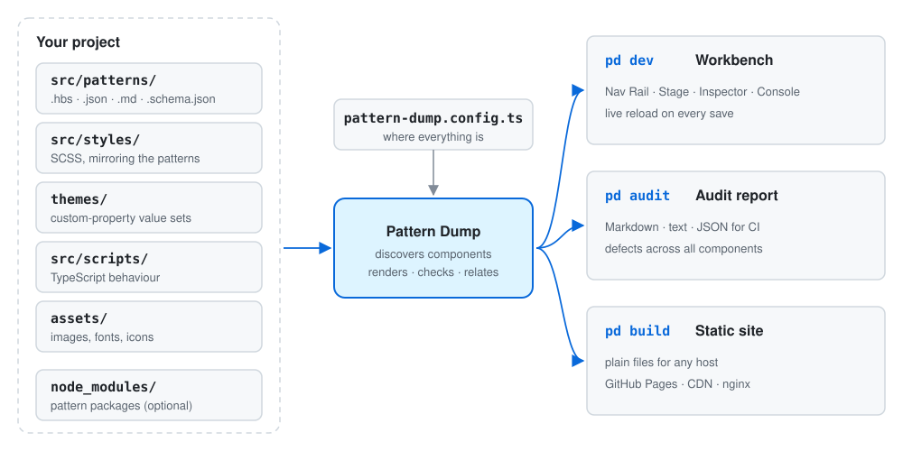

# Getting started

This guide takes you from an empty folder to a running workbench, a first component, an audit and a
static build.



**Requirements:** Node.js 22.22 or later, and npm.

## 1. Create a project

Pattern Dump installs into each project as a development dependency. `pd init` writes a starter
project and installs it.

```bash
npx pattern-dump init my-design-system
```

To try changes that are not released yet,
build the package from a clone of this repository and create the project from the file:

```bash
# in a clone of the Pattern Dump repository
npm install
npm run pack:pd          # → .pd-pack/pattern-dump-<version>.tgz

# anywhere else
npx --package=/path/to/pattern-dump-<version>.tgz pd init my-design-system --pd-source /path/to/pattern-dump-<version>.tgz
```

`pd init` asks for:

| Question | Flag | Default |
|---|---|---|
| A website on an existing style guide package? | `--site <package or folder>` | no: a new design system ([a content-only website](#a-content-only-website)) |
| Package name | `--name <name>` | the folder name; a generic one is scoped by its parent folder (below) |
| Title in the Nav Rail | `--brand <title>` | the name, or the parent folder's name for a scoped one |
| Include the starter components? | `--no-examples` to skip | yes |
| Include a website (storefront)? | `--with-site` | no |
| Include site search (Pagefind)? (with a website) | `--search` / `--no-search` | yes |
| Follow the viewer's light or dark setting? (with a website) | `--system-theme` / `--no-system-theme` | yes |
| Run `git init`? | `--git` / `--no-git` | yes, unless already inside a repository |
| Run `npm install`? | `--no-install` to skip | yes |

A folder name that says what a folder is rather than whose it is (`styleguide`, `style-guide`, `design-system`,
`site`, `website`, `docs`, `www`) is scoped by the folder it is in: `pd init styleguide` inside `acme-web/` makes the
package `@acme-web/styleguide`, titled `acme-web`. The question shows it as the default, `--yes` takes it, and init
prints the name it wrote.

A website adds pages written in markdown, a small skin and a GitHub Pages workflow; see
[storefront.md](storefront.md#quick-start). With search, Pagefind is a devDependency and `pd build` writes the
site's index. With the system theme, the default theme is `system` (`color-scheme: light dark`): the pages and the
examples on them follow the viewer's light or dark setting, with or without JavaScript.

`pattern-dump` (and Pagefind) are pinned to an exact version, since a patch release can change what a build writes
and checks. To move to a newer one:

```bash
npm install --save-dev --save-exact pattern-dump@<version>
```

The `package.json` also allows the install scripts of Pattern Dump's own dependencies, esbuild and
`@parcel/watcher` (`allowScripts`, which npm 11.19 asks for), so `npm install` has nothing to warn about. `--yes` accepts every default without asking. In a folder that already has a `package.json`, `pd init`
adds to the project and never overwrites a file; a script name that is taken gets a `pd:` prefix instead.

If `npm install` fails, the project's files are already written: `pd init` repeats npm's error lines after npm's
own output and says how to install again (`cd <folder> && npm install`). Fix what npm names, then run that; running
`pd init` again would find the project already there.

A global install (`npm install --global pattern-dump`) also works for creating projects, but each
project still uses its own local copy; see [global or local](cli.md#global-or-local).

## 2. What you get

```
my-design-system/
├── pattern-dump.config.ts     where everything is; every path resolves against this folder
├── package.json               dev, audit, typecheck and build:scripts scripts
├── tsconfig.json              TypeScript for the behaviour scripts
├── src/
│   ├── patterns/              components: .hbs templates, .json data, .md docs, .schema.json
│   │   ├── index.md           orders the top-level folders
│   │   ├── atoms/button/
│   │   ├── molecules/search-field/   (with a private input sub-component)
│   │   └── pages/example/
│   ├── styles/                SCSS mirroring src/patterns/
│   │   └── base/              shared rules linked beneath every preview
│   └── scripts/               behaviour scripts (TypeScript)
├── themes/
│   ├── light.theme.scss
│   └── dark.theme.scss
└── assets/                    served at /assets/
```

Each starter component shows one convention: variants as data or as their own markup, including one
component inside another, a private sub-component, a full-page layout and a behaviour script. The
project's own `README.md` summarises the conventions.

## 3. Run the workbench

```bash
cd my-design-system
npm run dev              # → http://localhost:4000
```

Edits to templates, data, docs, styles, themes and scripts show up without a page reload.

The workbench has four regions:

| Region | What it holds |
|---|---|
| **Nav Rail** (left) | The component tree and search; the theme picker; **Accessibility** (colour-vision simulation); viewport sizes (fit, fit content, mobile, tablet, desktop); buttons to show or hide the Inspector and Console; **Show private**; **Hide packages** when pattern packages are used |
| **Stage** (centre) | The live preview of the selected component or variant, a gallery of all variants, or a folder gallery |
| **Inspector** (right) | **Docs** (the component's `.md`), **Relationships** (what it uses and what uses it, including borrowed CSS classes), **Audit** (defects across all components) |
| **Console** (bottom) | **Source** (template, data, schema), **HTML** (the rendered markup), **Diagnostics** (render, schema, HTML validation and accessibility findings), **Console** (messages from the server; a warning starts with `Warning:` and has an orange mark at its left edge, an error is red) |

Every view has its own address, so links, reloads and the browser's Back button work. PatternLab-style
links (`/#/atoms/button`) open the same view, and an address that names nothing says so and links the
closest match.

## 4. Add a component

A component is a Handlebars template anywhere under `src/patterns/`. Create
`src/patterns/atoms/badge/badge.hbs`:

```handlebars
<span class="badge">{{label}}</span>
```

Give it data in `badge.json`:

```json
{ "label": "New" }
```

Style it in `src/styles/atoms/badge.scss`:

```scss
.badge {
  padding: 0.125rem 0.5rem;
  border-radius: 999px;
  background: var(--color-primary);
  color: var(--color-on-primary);
}
```

Document it in `badge.md`:

```md
---
title: Badge
status: draft
---

A short label.
```

It appears in the Nav Rail as soon as the file exists. Include it in another component with its
handle, `{{> atoms-badge label="Beta" }}`.

Add a variant with a data file next to it, `badge~warning.json`:

```json
{ "label": "Deprecated" }
```

The full set of conventions is in [authoring.md](authoring.md).

## 5. Audit

```bash
npm run audit
```

`pd audit` renders every component with its own data and reports defects: render errors, schema mismatches,
HTML validation and structural accessibility checks. The same results appear in the workbench's
**Audit** tab. See [cli.md](cli.md#pd-audit) for the report formats.

## 6. Publish a static build

```bash
npx pd build             # → ./dist
```

`pd build` writes the whole workbench as plain files that any static host can serve. See
[static-build.md](static-build.md).

## A content-only website

`pd init <dir> --site <package or folder>` writes a website whose components, styles, themes and skin all come from
a style guide package. The project is pages and a config, nothing else:

```bash
npx pattern-dump init site --site @acme/styleguide         # from the npm registry (a version: @acme/styleguide@1.2.0)
npx pattern-dump init site --site ../styleguide            # a folder next to it, as a file: dependency
```

| File | What |
|---|---|
| `package.json` | `dev` and `build`; `pattern-dump`, the style guide and (with search) Pagefind as devDependencies |
| `pattern-dump.config.ts` | `packages: ["<the style guide>"]`, the `site` block, and `build: { workbench: false }` |
| `pages/index.md`, `pages/about.md` | two pages that name no layout, so they render with the style guide's `layouts/page` |
| `.gitignore`, `README.md` | |
| `.github/workflows/pages.yml` | for a style guide from the registry: builds the website and publishes it |

- **The style guide is checked.** After `npm install`, init asks the site's dev server for every page. A package
  without a skin (`layouts/page` and `partials/base`) or without a `patternDump` field is named then, with what is
  missing; the site is written either way.
- **A style guide in a folder without the `patternDump` field** gets the block to add, printed by init: the folders
  its `pattern-dump.config.ts` names, ready to paste into its `package.json`. A style guide made by `pd init` has the
  field already.
- **Its workbench is the style guide's.** `--workbench-url` (default `/workbench/`) says where the style guide
  publishes its own workbench; the pages' examples link there. `build.workbench: false` makes `pd build` write the
  website only, to `site/`.
- **A version given is kept; none given is pinned** to the version `npm install` installed.

### A style guide and its site in one repository

Two inits and a root `package.json`. The style guide is a design system with a website starter (for its skin):

```bash
mkdir acme-web && cd acme-web
npx pattern-dump init styleguide --with-site --no-git    # @acme-web/styleguide
```

Init writes the `patternDump` field into `styleguide/package.json`, naming the same folders as its config (a folder
named in both must be the same in both), so the style guide is a pattern package from the start:

```json
"patternDump": {
  "patterns": "src/patterns",
  "styles": { "dir": "src/styles", "documentBase": ["base"] },
  "themes": { "dir": "themes", "default": "system", "switch": "attribute" },
  "scripts": "src/scripts",
  "assets": ["assets"]
}
```

Then the site, on the folder, and the root:

```bash
npx pattern-dump init site --site ../styleguide --no-git  # @acme-web/site
rm -r styleguide/.github                                  # GitHub reads workflows from the root only
```

```json
{
  "name": "acme-web",
  "private": true,
  "workspaces": ["styleguide", "site"],
  "scripts": {
    "dev": "npm run dev -w @acme-web/site",
    "dev:styleguide": "npm run dev -w @acme-web/styleguide -- --port 4300",
    "build": "npm run build -w @acme-web/site",
    "pages": "npm run build -w @acme-web/site && npm run build -w @acme-web/styleguide -- --base /workbench/ && node scripts/assemble-pages.mjs"
  }
}
```

`scripts/assemble-pages.mjs` puts both builds into one folder for GitHub Pages: `site/site/` at its root, and
`styleguide/dist/` under `workbench/`:

```js
import { cp, rm } from "node:fs/promises";
import { existsSync } from "node:fs";

for (const dir of ["site/site", "styleguide/dist"]) if (!existsSync(dir)) throw new Error(`${dir} is missing: run npm run pages`);
await rm("_site", { recursive: true, force: true });
await cp("site/site", "_site", { recursive: true });
await cp("styleguide/dist", "_site/workbench", { recursive: true });
```

The root's `.github/workflows/pages.yml` is the one `pd init --with-site` writes, with its build and copy steps
replaced by `- run: npm run pages`. Run `npm install` at the root once, so there is one lockfile; add `_site` to
the root's `.gitignore`. People who write content work in `site/pages/` only.

## Next

- [authoring.md](authoring.md): components, variants, data, docs, ordering, scripts and assets
- [configuration.md](configuration.md): every option in `pattern-dump.config.ts`
- [themes.md](themes.md): writing and switching themes
- [pattern-packages.md](pattern-packages.md): using a design system from npm next to your own patterns
- [cli.md](cli.md): every command and flag
